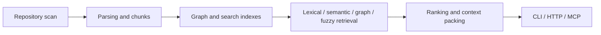

# Semantica Codegraph

A Python code graph and hybrid retrieval system for code-understanding tools. It connects parsing, chunks, code relationships, and embeddings behind CLI, HTTP, and MCP interfaces.

## Retrieval pipeline



## Repository map

| Path | Responsibility |
| --- | --- |
| [src/parser](src/parser) | Python/TypeScript parsing, SCIP integration, and text handling |
| [src/indexer](src/indexer) | Repository scanning and indexing pipeline |
| [src/chunking](src/chunking) | Chunk creation and storage |
| [src/graph](src/graph) | Code relationships and PostgreSQL storage |
| [src/embedding](src/embedding) | Embedding providers and pgvector storage |
| [src/search](src/search) | Retrieval adapters, ranking, and context packing |
| [apps](apps) | Interactive CLI, FastAPI, and MCP server |

[Bootstrap](src/core/bootstrap.py) assembles dependencies. [Configuration](src/core/config.py) defines environment-variable behavior.

## Local development

Use Python 3.10+.

```sh
python -m venv .venv
source .venv/bin/activate
python -m pip install -e ".[dev]"
```

Storage/retrieval paths require PostgreSQL/pgvector and a selected lexical backend. [docker-compose.yml](docker-compose.yml) expects a local `.env`. The default embedding configuration uses Codestral Embed and requires provider configuration such as `EMBEDDING_API_KEY`.

| Command | Interface |
| --- | --- |
| `semantica` | Interactive CLI |
| `semantica-api` | HTTP API |
| `semantica-mcp` | MCP server |

Installing the package does not provision schemas, indexes, or external providers.

## Tests and status

```sh
python -m pytest
```

This is the earlier Python implementation. It retains parser, indexing, storage, retrieval, and integration tests. Integration tests require their backing services. Its capabilities and historical evidence are separate from the newer Rust analysis system.

## Documentation

- [Search pipeline example](examples/full_search_pipeline.py)
- [CLI development](docs/cli-development-guide.md)
- [Database migrations](.doc/migrations-guide.md)
- [Benchmark workflow](.doc/benchmarks-guide.md)
